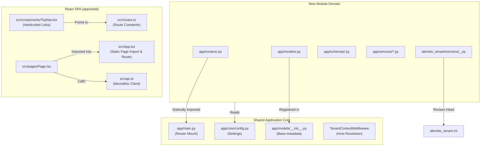

# ANTIGRAVITY — TruckERP Module Onboarding Architecture Audit

**Repository**: `mkaamirerp/trucking-erp`  
**Audit Type**: Independent, Read-Only Architecture & Fault-Isolation Audit  
**Status**: Completed (Read-Only — No modifications applied)  
**Governing Rule**: `AGENTS.md` / `.cursor/rules/agents-charter.mdc`  

---

## Executive Summary

TruckERP V1 is an integrated trucking ERP application with a shared core (FastAPI, PostgreSQL multi-tenancy, React SPA, shared services) and multiple business modules (Loads/Dispatch, Fleet, People/HR, Fuel, Tolls, Payroll, Load Lab, Document Ingestion).

Per the architectural charter (`AGENTS.md`):
> *"TruckERP is one proprietary application with a shared core... A new module must not break existing modules. Making the assigned feature work is NOT permission to change another module's behavior."*

This audit evaluated how new modules are introduced, registered, and integrated into TruckERP. The focus was specifically on **fault isolation, change isolation, and blast-radius containment** within a single monolithic codebase.

### Key Audit Conclusions

1. **Physical Tenant Isolation is Strong, but Operational Migration is Fragile**: Physical database separation per tenant (`tenant_<slug>`) provides solid runtime storage isolation. However, migration execution is single-tenant manual, and tenant schema validation on provisioning checks only 3 legacy tables (`people`, `person_roles`, `driver_profiles`), leaving newly onboarded module tables unvalidated.
2. **CI Tenant Safety Enforcement is Inactive Due to Dead Paths**: The repository's primary tenant safety CI checks (`scripts/ci_tenant_safety_grep.sh` and `tests/ci/test_no_platform_db_in_tenant_code.py`) scan directories (`app/routers/tenant`, `app/services/tenant`) that **do not exist**. Consequently, CI reports green while live tenant routers (e.g., `app/routers/fuel.py`) actively mix platform and tenant database sessions.
3. **The "STOP Rule" is Procedural, Not Automated**: The mandatory architecture gate (*STOP → REPORT → INVESTIGATE → REQUEST APPROVAL*) is documented in `AGENTS.md` and Cursor rules, but has **zero automated enforcement** in CI or git hooks for application code (unlike infra files which are guarded by `config_guard.yml`).
4. **Monolithic Frontend Single Point of Failure**: All modules share a single 5,265-line API file (`apps/web/src/api.ts`) and static imports in `apps/web/src/App.tsx`. A single syntax or typing error in any module breaks the entire web application. Navigation links in `TopNav.tsx` are exposed unconditionally without module enablement checks.
5. **Dual-Database Writes Risk Data Drift**: Onboarding modules that touch both platform secrets and tenant entities (e.g., Fuel provider connections) perform uncoordinated dual-database writes across separate database engines in a single HTTP request without distributed transaction or compensation guarantees.

---

## A. Current Onboarding Flow

When a new module (e.g., Fuel, Tolls, Load Lab) is onboarded into TruckERP, it touches the following layers:



### Detailed Lifecycle Steps

1. **Backend Routing & App Initialization**:
   - The developer creates `app/routers/<module>.py`.
   - The router is statically imported at the top level of [`app/main.py`](file:///home/admin/trucking_erp/app/main.py#L9-L54).
   - The router is mounted via `app.include_router(<module>_router, prefix="/api/v1")` or directly mounted in [`app/main.py`](file:///home/admin/trucking_erp/app/main.py#L129-L174).
   - If the endpoint requires bypassing tenant resolution (e.g., public webhook or intake), the path must be manually added to `DEFAULT_ALLOW_PATHS` in [`app/middleware/tenant_context.py`](file:///home/admin/trucking_erp/app/middleware/tenant_context.py#L23-L39).

2. **Database Models & Alembic Migrations**:
   - The developer defines models in `app/models/<module>.py` subclassing `Base` from [`app/models/base.py`](file:///home/admin/trucking_erp/app/models/base.py#L3).
   - The models are imported into [`app/models/__init__.py`](file:///home/admin/trucking_erp/app/models/__init__.py#L1-L95), registering them on the shared `Base.metadata`.
   - The developer creates a migration in [`alembic_tenant/versions/`](file:///home/admin/trucking_erp/alembic_tenant/versions) using `alembic -c alembic_tenant.ini revision`.
   - Any foreign key referencing `people` must be a composite key `(tenant_id, person_id)`, or `scripts/tenant_migrate_preflight.sh` will reject it.

3. **Database Migration Deployment & Tenant Provisioning**:
   - **New Tenants**: [`app/services/tenant_provisioning.py`](file:///home/admin/trucking_erp/app/services/tenant_provisioning.py#L204-L209) provisions a new PostgreSQL database `tenant_<slug>`, runs `alembic -c alembic_tenant.ini upgrade head`, and calls `validate_tenant_schema_strict(tenant_db_url)`.
   - **Existing Tenants**: Operators must execute [`scripts/tenant_upgrade_head.sh`](file:///home/admin/trucking_erp/scripts/tenant_upgrade_head.sh#L44-L45) with `ALEMBIC_TENANT_DATABASE_URL` pointed to a single target database.

4. **Tenant Context & Request Handling**:
   - Inbound requests hit [`TenantContextMiddleware`](file:///home/admin/trucking_erp/app/middleware/tenant_context.py#L84-L310), which parses the `Host` header (e.g. `acme.truckerp.me`), queries `PlatformTenant` in the Platform DB, and attaches `request.state.tenant_id` and `request.state.tenant_slug`.
   - Endpoints inject `db: AsyncSession = Depends(get_tenant_db)` from [`app/deps/tenant_db.py`](file:///home/admin/trucking_erp/app/deps/tenant_db.py#L90-L121), which checks out a connection pool for `tenant_<slug>`.

5. **Authentication & Authorization**:
   - Endpoints require `user: CurrentUser = Depends(get_current_user)` from [`app/deps/auth.py`](file:///home/admin/trucking_erp/app/deps/auth.py#L81).
   - Role checks are performed via custom dependencies: `require_tenant_admin` ([`app/dependencies/authz.py`](file:///home/admin/trucking_erp/app/dependencies/authz.py#L7)), module-specific gates like `require_fuel_capability` ([`app/deps/fuel_rbac.py`](file:///home/admin/trucking_erp/app/deps/fuel_rbac.py#L53)), or experimental Casbin wrappers like `require_pilot_capability` ([`app/authz/enforce.py`](file:///home/admin/trucking_erp/app/authz/enforce.py#L78)).

6. **Frontend Integration**:
   - Route path constants are declared in [`apps/web/src/routes.ts`](file:///home/admin/trucking_erp/apps/web/src/routes.ts).
   - The page component is statically imported and mounted in [`apps/web/src/App.tsx`](file:///home/admin/trucking_erp/apps/web/src/App.tsx#L1-L67), and the path is added to the `isAppRoute` regex check ([`App.tsx:79-93`](file:///home/admin/trucking_erp/apps/web/src/App.tsx#L79-L93)).
   - Top-level navigation items are added to static arrays in [`apps/web/src/components/TopNav.tsx`](file:///home/admin/trucking_erp/apps/web/src/components/TopNav.tsx#L11-L61).
   - API caller functions, request/response types, and error parsers are appended directly into [`apps/web/src/api.ts`](file:///home/admin/trucking_erp/apps/web/src/api.ts).

---

## B. Existing Protections (What Already Works)

The following architectural mechanisms currently function properly to maintain isolation:

1. **Strict Physical Database Separation (Tenant vs Platform)**:
   - Platform control plane data lives in `trucking_erp` (`PlatformTenant`, `PlatformUser`, `PlatformSubscription`).
   - Tenant operational data lives in dedicated, physically isolated databases `tenant_<slug>`.
   - Cross-tenant data leakage via SQL query mistakes is prevented by PostgreSQL database-level isolation.
2. **Subdomain-Driven Tenant Context**:
   - [`TenantContextMiddleware`](file:///home/admin/trucking_erp/app/middleware/tenant_context.py#L111-L126) resolves tenant identity strictly from trusted Host subdomains and verified JWTs. Client-supplied headers like `X-Tenant-ID` or `X-Tenant-Slug` are strictly ignored for routing.
3. **Linear Alembic Migration Guards in CI**:
   - [`.github/workflows/alembic_guard.yml`](file:///home/admin/trucking_erp/.github/workflows/alembic_guard.yml#L60-L83) enforces that both `alembic_platform.ini` and `alembic_tenant.ini` have exactly 1 head.
   - `scripts/ci_check_alembic_down_revision.sh` and `scripts/ci_check_alembic_platform_tenant_ids.sh` prevent branching migration trees and revision collision between platform and tenant schemas.
4. **People-First Foreign Key Preflight Verification**:
   - [`scripts/tenant_migrate_preflight.sh`](file:///home/admin/trucking_erp/scripts/tenant_migrate_preflight.sh#L164-L188) queries `pg_constraint` to ensure that any table referencing `people` includes `tenant_id` in a composite foreign key `(tenant_id, person_id)` and verifies zero orphan rows.
5. **SSM Environment & Secret Protection**:
   - Application secrets are loaded exclusively via AWS SSM into `/run/secrets/truckerp.env`.
   - [`app/main.py:56-70`](file:///home/admin/trucking_erp/app/main.py#L56-L70) and [`app/core/config.py:169-190`](file:///home/admin/trucking_erp/app/core/config.py#L169-L190) fail closed on startup if `ENVIRONMENT` is missing or if placeholder JWT secrets are detected in production/staging.
6. **Infrastructure Diff Gate (`config_guard.yml`)**:
   - [`.github/workflows/config_guard.yml`](file:///home/admin/trucking_erp/.github/workflows/config_guard.yml#L72-L100) blocks PRs modifying `.env`, `docker-compose*.yml`, or `scripts/*ssm*.sh` unless `CONFIG-CHANGE:` is explicitly approved in the PR title or commit message.
7. **Durable Domain Event Outbox**:
   - Domain events are written transactionally to `domain_event_outbox` in the tenant DB rather than directly invoking downstream HTTP or messaging calls inside business operations.

---

## C. Confirmed Weaknesses

### Finding 1: Hollow CI Tenant Safety Gate Due to Dead Directory Paths
- **Category**: CI / Enforcement Failure (Confirmed)
- **File & Lines**: [`scripts/ci_tenant_safety_grep.sh:5-22`](file:///home/admin/trucking_erp/scripts/ci_tenant_safety_grep.sh#L5-L22), [`tests/ci/test_no_platform_db_in_tenant_code.py:3-8`](file:///home/admin/trucking_erp/tests/ci/test_no_platform_db_in_tenant_code.py#L3-L8), [`tests/ci/test_tenant_repo_signatures.py:5-8,49`](file:///home/admin/trucking_erp/tests/ci/test_tenant_repo_signatures.py#L5-L8).
- **Evidence**:
  ```sh
  # In scripts/ci_tenant_safety_grep.sh:
  TENANT_DIRS="
  app/routers/tenant
  app/services/tenant
  app/repos/tenant
  tenant_api
  "
  ```
  Actual disk check shows:
  ```
  ls: cannot access 'app/routers/tenant': No such file or directory
  ls: cannot access 'app/services/tenant': No such file or directory
  ls: cannot access 'app/repos/tenant': No such file or directory
  ```
  `tenant_api` contains only 4 legacy files. The live tenant routers (`fuel.py`, `tolls.py`, `loads.py`, `trips.py`) and services (`loads.py`, `fuel_*.py`, `tolls_*.py`) reside directly under `app/routers/` and `app/services/`.
- **Failure Scenario**:
  The CI workflow `.github/workflows/ci-tenant-safety.yml` passes unconditionally, reporting `✅ CI tenant safety checks passed`, while scanning almost zero lines of actual code. Any new module can introduce raw SQL, un-scoped queries, or forbidden platform DB imports without failing CI.
- **Affected Modules**: All tenant modules, tenant data isolation.
- **Smallest Safe Remedy**: Update `TENANT_DIRS` in `scripts/ci_tenant_safety_grep.sh` and `tests/ci/test_no_platform_db_in_tenant_code.py` to scan `app/routers/` and `app/services/`, filtering out explicit platform files (`platform_*.py`, `public_signup.py`, `auth.py`, `workspace_intake.py`).

---

### Finding 2: Platform and Tenant Database Session Mixing in Tenant Routers
- **Category**: Architecture Violation / Distributed Transaction Risk (Confirmed)
- **File & Lines**: [`app/routers/fuel.py:18,140,169`](file:///home/admin/trucking_erp/app/routers/fuel.py#L18), [`app/routers/people_workspace.py:11,353`](file:///home/admin/trucking_erp/app/routers/people_workspace.py#L11).
- **Evidence**:
  In [`app/routers/fuel.py`](file:///home/admin/trucking_erp/app/routers/fuel.py#L135-L144):
  ```python
  @router.post("/provider-connections", response_model=FuelProviderConnectionOut)
  async def create_fuel_provider_connection(
      payload: FuelProviderConnectionWrite,
      user: CurrentUser = Depends(require_fuel_capability(FUEL_PROVIDERS_MANAGE)),
      tenant_id: int = Depends(require_tenant),
      db: AsyncSession = Depends(get_tenant_db),
      platform_db: AsyncSession = Depends(get_db),
  ):
      row = await connections_service.create_connection(
          db, platform_db, tenant_id=tenant_id, payload=payload, actor=user
      )
  ```
  This directly violates the canonical rule in `docs/platform/security/tenant_safety_forbidden_sql.md`:
  > *"1A) Platform DB dependency inside tenant code: Forbidden: `from app.deps.db import get_db`, `Depends(get_db)`. Any use of platform DB session inside tenant routers/services/repos."*
- **Failure Scenario**:
  The handler executes mutations against two separate PostgreSQL databases in a single HTTP request without two-phase commit. If writing the secret in `platform_db` succeeds but writing `FuelProviderConnection` in `db` fails, orphaned secrets remain in the platform DB. If the order is reversed, a tenant connection exists pointing to missing platform credentials.
- **Affected Modules**: Fuel module, Platform integration secret store.
- **Smallest Safe Remedy**: Decouple tenant operations from direct platform DB access. Store encrypted provider credentials within the tenant DB, or wrap cross-DB coordination in an explicit rollback compensation block.

---

### Finding 3: Monolithic Alembic Target Metadata Across Platform and Tenant DBs
- **Category**: Schema Drift / Migration Conflict Risk (Confirmed)
- **File & Lines**: [`app/models/__init__.py:1-95`](file:///home/admin/trucking_erp/app/models/__init__.py#L1-L95), [`alembic_tenant/env.py:55-58`](file:///home/admin/trucking_erp/alembic_tenant/env.py#L55-L58), [`alembic_platform/env.py:47-50`](file:///home/admin/trucking_erp/alembic_platform/env.py#L47-L50).
- **Evidence**:
  Both `alembic_tenant/env.py` and `alembic_platform/env.py` configure Alembic with:
  ```python
  from app.models.base import Base
  import app.models

  target_metadata = Base.metadata
  ```
  `app/models/__init__.py` imports ALL platform models (`PlatformTenant`, `PlatformUser`, `PlatformSubscription`, `ReservedSlug`) AND ALL tenant models (`Load`, `Trip`, `FuelTransaction`, `TollTransaction`, `Driver`).
- **Failure Scenario**:
  Running `alembic revision --autogenerate` against either database without custom filters will cause Alembic to generate `CREATE TABLE` or `DROP TABLE` operations for tables belonging to the other database. If a developer runs autogenerate on tenant DB, it attempts to generate DDL for platform tables.
- **Affected Modules**: All database migrations, Platform DB, Tenant DB.
- **Smallest Safe Remedy**: Add an `include_object` hook in both `alembic_tenant/env.py` and `alembic_platform/env.py` that filters tables by name (e.g., ignoring `platform_*` in tenant migrations and ignoring business tables in platform migrations).

---

### Finding 4: Incomplete Tenant Provisioning Schema Validation
- **Category**: Data Integrity / Provisioning Failure (Confirmed)
- **File & Lines**: [`app/services/tenant_schema_validation.py:45-53,95-103`](file:///home/admin/trucking_erp/app/services/tenant_schema_validation.py#L45-L53), [`app/services/tenant_provisioning.py:207-209`](file:///home/admin/trucking_erp/app/services/tenant_provisioning.py#L207-L209).
- **Evidence**:
  In `app/services/tenant_schema_validation.py`:
  ```python
  required_tables = {
      "people",
      "person_roles",
      "driver_profiles",
  }
  ```
  `validate_tenant_schema_strict` runs on every new tenant database creation, but only verifies that those 3 tables exist. It checks zero tables for Loads, Trips, Fleet, Fuel, Tolls, or Payroll.
- **Failure Scenario**:
  If a new module's migration fails silently or partially during tenant provisioning (or is skipped due to revision mismatch), `validate_tenant_schema_strict` reports success. The tenant is marked `db_status = "READY"`. When the user later attempts to use the new module, operations crash with `UndefinedTable` runtime errors.
- **Affected Modules**: Tenant onboarding, all newly introduced business modules.
- **Smallest Safe Remedy**: Extend `validate_tenant_schema` to verify that all core business module anchor tables (e.g., `loads`, `trips`, `trucks`, `fuel_transactions`, `toll_transactions`, `pay_runs`) are present, or verify that the DB's `alembic_version` matches the expected single head revision.

---

### Finding 5: Lack of Automated Fleet-Wide Tenant Migration Execution
- **Category**: Deployment & Compatibility Risk (Confirmed)
- **File & Lines**: [`scripts/tenant_upgrade_head.sh:44-45`](file:///home/admin/trucking_erp/scripts/tenant_upgrade_head.sh#L44-L45), [`scripts/run_tenant_migrations.py:82-99`](file:///home/admin/trucking_erp/scripts/run_tenant_migrations.py#L82-L99).
- **Evidence**:
  `scripts/tenant_upgrade_head.sh` only executes against whatever single URL is exported in `ALEMBIC_TENANT_DATABASE_URL`:
  ```bash
  echo "Running: alembic -c /app/alembic_tenant.ini upgrade head"
  cd /app && alembic -c /app/alembic_tenant.ini upgrade head
  ```
  There is no automated script or deployment step that queries `PlatformTenant` to migrate all existing active tenant databases when a new module adds a migration.
- **Failure Scenario**:
  When a new module is merged to `main` with a new migration, newly provisioned tenants receive it, but existing tenant databases (e.g. `tenant_demo`, customer tenants) remain at the old revision unless an operator manually runs migrations for every individual tenant. If an existing tenant accesses the new module, queries crash.
- **Affected Modules**: All existing tenants, any module adding migrations.
- **Smallest Safe Remedy**: Provide a canonical operator script `scripts/migrate_all_active_tenants.py` that queries active tenants from `PlatformTenant`, runs preflight, executes the upgrade for each tenant database, and logs any failures without halting remaining tenants.

---

### Finding 6: The "STOP Rule" Has Zero Automated CI / Git Enforcement
- **Category**: Process & Change Isolation Risk (Confirmed)
- **File & Lines**: [`AGENTS.md`](file:///home/admin/trucking_erp/AGENTS.md), [`.cursor/rules/agents-charter.mdc`](file:///home/admin/trucking_erp/.cursor/rules/agents-charter.mdc), [`.github/workflows/config_guard.yml`](file:///home/admin/trucking_erp/.github/workflows/config_guard.yml).
- **Evidence**:
  `AGENTS.md` mandates:
  > *"STOP before making a change if the task requires... changing an existing table, column, foreign key, relationship, constraint, enum... changing shared People/Driver/Asset/Load models, tenant identity, authentication, permissions... STOP → REPORT → INVESTIGATE → REQUEST APPROVAL."*
  
  While `config_guard.yml` automatically enforces approval for `.env` and `docker-compose.yml`, there is **no corresponding GitHub Action or pre-commit hook** for application code.
- **Failure Scenario**:
  An agent or developer onboarding a new module (e.g. Driver's License Parser or Fuel) can directly edit `app/models/person.py`, alter `app/models/load.py`, or modify `app/deps/auth.py` in a PR. The PR will pass all existing CI checks without requiring any `CORE-CHANGE:` or `SCHEMA-CHANGE:` approval flag.
- **Affected Modules**: Shared Core, Loads, Dispatch, People, Auth.
- **Smallest Safe Remedy**: Create a lightweight GitHub Actions workflow (`shared_core_guard.yml`) modeled after `config_guard.yml` that detects changes to protected shared core paths (`app/models/person.py`, `app/models/load.py`, `app/models/trip.py`, `app/deps/auth.py`, `app/deps/tenant_db.py`, `app/main.py`) and fails unless the commit message or PR title contains an explicit approval tag (e.g., `CORE-CHANGE:`).

---

### Finding 7: Frontend Monolithic API & Unsplit Bundling Single Point of Failure
- **Category**: Frontend Fault Isolation (Confirmed)
- **File & Lines**: [`apps/web/src/api.ts:1-5265`](file:///home/admin/trucking_erp/apps/web/src/api.ts), [`apps/web/src/App.tsx:1-67,79-93`](file:///home/admin/trucking_erp/apps/web/src/App.tsx#L1-L67), [`apps/web/src/components/TopNav.tsx:11-34`](file:///home/admin/trucking_erp/apps/web/src/components/TopNav.tsx#L11-L34).
- **Evidence**:
  - `apps/web/src/api.ts` is 5,265 lines long. It consolidates every API endpoint, schema interface, and payload validator for Loads, Trips, Dispatch, Drivers, Fleet, Fuel, Tolls, Payroll, and Admin into a single file.
  - In `apps/web/src/App.tsx`, 60+ page components are statically imported at the top of the file (only `DlCapturePage` uses `lazy()`).
  - In `apps/web/src/components/TopNav.tsx`, links to all modules (`Fuel`, `Tolls`, `Payroll`, `Trip Container`, `Loads`, `Brokers`) are rendered unconditionally for all logged-in users.
- **Failure Scenario**:
  1. A developer working on a new module introduces a TypeScript syntax error or corrupts a shared helper in `api.ts`. The entire frontend build (`npm run build`) fails, blocking all releases across all business modules.
  2. Because page components are bundled together without lazy loading, an unhandled exception thrown in a module's top-level script scope crashes the entire React application on load.
  3. Every user sees navigation links to every module regardless of whether the tenant has access, leading to confusing 403 Forbidden errors when clicked.
- **Affected Modules**: Entire React web application.
- **Smallest Safe Remedy**:
  1. Implement route-level code splitting in `App.tsx` using `React.lazy()` and `<Suspense>` for module pages.
  2. Organize API client functions into domain sub-modules (e.g., `apps/web/src/api/fuel.ts`, `apps/web/src/api/tolls.ts`) importing the shared base fetcher.
  3. Add visibility/entitlement filtering to `TopNav.tsx`.

---

### Finding 8: Monolithic Backend Imports & Startup Crash Cascades
- **Category**: Backend Fault Isolation (Confirmed)
- **File & Lines**: [`app/main.py:9-54,129-174`](file:///home/admin/trucking_erp/app/main.py#L9-L54).
- **Evidence**:
  45+ router modules are statically imported in `app/main.py` at module load time.
- **Failure Scenario**:
  If a newly onboarded router (e.g. `load_lab.py` or `tolls.py`) contains a top-level import error, references an uninstalled package, has a circular dependency, or executes an unhandled expression during import, `app.main` fails to import. Uvicorn crashes immediately on boot, taking down the entire API for all existing modules.
- **Affected Modules**: All modules (Loads, Dispatch, Payroll, HR, Fleet).
- **Smallest Safe Remedy**: Add a fast pre-merge CI test that executes `python -m compileall app/` and a smoke test `tests/test_app_startup_import.py` verifying that `from app.main import app` succeeds cleanly in an isolated test environment.

---

### Finding 9: Global `Settings` Pollution & Import-Time Validation Crash Risk
- **Category**: Configuration Isolation (Confirmed)
- **File & Lines**: [`app/core/config.py:32-152,154-190`](file:///home/admin/trucking_erp/app/core/config.py#L32-L152).
- **Evidence**:
  `settings = Settings()` is instantiated at the module level in `app/core/config.py`. All module-specific settings (Gmail OAuth, Microsoft 365, Turnstile, OpenAI, Casbin pilot flags) are attributes of this single class. Top-level functions `_validate_database_url` and `enforce_jwt_secret_policy` execute immediately upon importing `app.core.config`.
- **Failure Scenario**:
  If a new module adds a required setting to `Settings` without a default value, or introduces top-level validation that fails in certain environments (e.g. CI test runners or local development), importing `settings` in any script, migration, or unit test crashes immediately.
- **Affected Modules**: All modules, test suites, and migration CLI tools.
- **Smallest Safe Remedy**: Ensure all module-specific settings in `Settings` are optional with safe defaults (e.g., `str | None = None`). Never raise validation exceptions at module import time for module-specific features.

---

### Finding 10: Inconsistent Route Prefixes and Registration Conventions
- **Category**: Routing & API Contract Consistency (Confirmed)
- **File & Lines**: [`app/main.py:129-174`](file:///home/admin/trucking_erp/app/main.py#L129-L174).
- **Evidence**:
  Routing prefixes are mounted inconsistently in `app/main.py`:
  - Some routers specify `prefix="/api/v1"` in `app.include_router(...)`:
    `app.include_router(loads_router, prefix="/api/v1")`
    `app.include_router(fuel_router, prefix="/api/v1")`
    `app.include_router(tolls_router, prefix="/api/v1")`
  - Other routers embed `/api/v1` in their own file and are mounted without a prefix:
    `app.include_router(payroll_router)` (prefix `/api/v1/payroll` inside router)
    `app.include_router(pay_runs_router)` (prefix `/api/v1/pay-runs` inside router)
    `app.include_router(auth_router)`
    `app.include_router(tenant_admin_router)`
  - Some routers specify a custom prefix:
    `app.include_router(workspace_intake_router, prefix="/api/v1/public")`
- **Failure Scenario**:
  A new module developer can easily create route collision, accidental double-prefixing (e.g. `/api/v1/api/v1/...`), or register an un-prefixed route that unintentionally bypasses `TenantContextMiddleware` (which specifically gates routes starting with `self.api_prefix = "/api/v1/"`).
- **Affected Modules**: New modules, API routing predictability.
- **Smallest Safe Remedy**: Standardize route prefixing: routers declare domain-relative prefixes (e.g. `prefix="/fuel"`), and `app/main.py` mounts all tenant/business routers with `prefix="/api/v1"`.

---

## D. Cross-Module Impact Matrix

| Onboarded Module | Intersecting Existing Module | Coupling / Dependency Type | Failure Mode / Blast Radius | Risk Level |
| :--- | :--- | :--- | :--- | :--- |
| **Fuel** (`fuel.py`) | **Platform DB Secrets** (`TenantIntegrationSecret`) | Dual-database active sessions (`db` + `platform_db`) | Partial write failure creates orphaned credentials or broken connections. | **HIGH** |
| **Tolls** (`toll.py`) | **Fleet / Trucks** (`trucks`) | Hard compound foreign key: `["tenant_id", "truck_id"]` -> `["trucks.tenant_id", "trucks.id"]` | Alterations to `trucks` table PK/schema break Toll transactions constraints. | **MEDIUM** |
| **Payroll** (`payroll.py`) | **People / Drivers** (Legacy `drivers`) | Single-column FK: `ForeignKey("drivers.id")` | Violates People-First rule; blocks deprecation/cleanup of legacy `drivers` table. | **HIGH** |
| **Load Lab** (`load_lab.py`) | **OpenAI / Document Platform** | External HTTP API / AI extraction tokens | Missing API keys or network timeouts in Load Lab must not block normal Load intake. | **LOW** (isolated) |
| **All New Modules** | **Tenant Database Migration Fleet** | Alembic tenant schema migrations | Existing active tenants are not migrated automatically; queries fail with `UndefinedTable`. | **HIGH** |
| **All New Modules** | **FastAPI Core App** (`main.py`) | Static module imports in `app/main.py` | Import-time syntax or dependency failure crashes entire application on startup. | **CRITICAL** |
| **All New Modules** | **React Frontend** (`api.ts`, `App.tsx`) | Monolithic `api.ts` & static page imports | Single TS/bundling error in new module breaks web UI for all users. | **HIGH** |

---

## E. Recommended Improvements

### Critical Priority (Immediate Action)
1. **Fix CI Tenant Safety Grep & Test Target Paths**:
   - Update [`scripts/ci_tenant_safety_grep.sh`](file:///home/admin/trucking_erp/scripts/ci_tenant_safety_grep.sh#L5-L10) and [`tests/ci/test_no_platform_db_in_tenant_code.py`](file:///home/admin/trucking_erp/tests/ci/test_no_platform_db_in_tenant_code.py#L3-L8) to scan `app/routers/` and `app/services/` (excluding platform-explicit files).
   - Restore mechanical enforcement of tenant database isolation.
2. **Automate the "STOP Rule" in CI (`shared_core_guard.yml`)**:
   - Implement a GitHub Actions workflow that detects changes to protected shared core paths (`app/models/person.py`, `app/models/load.py`, `app/models/trip.py`, `app/deps/auth.py`, `app/deps/tenant_db.py`, `app/main.py`).
   - Block PRs modifying these files unless an explicit approval marker (e.g. `CORE-CHANGE:` or `SCHEMA-CHANGE:`) is present in the PR title or commit message.
3. **Decouple Alembic Target Metadata for Platform vs Tenant**:
   - Add an `include_object` hook in [`alembic_tenant/env.py`](file:///home/admin/trucking_erp/alembic_tenant/env.py#L83-L89) and [`alembic_platform/env.py`](file:///home/admin/trucking_erp/alembic_platform/env.py#L103-L109) to ignore tables belonging to the other database, preventing accidental autogenerate pollution.

### High Priority
4. **Implement Fleet-Wide Tenant Migration Automation**:
   - Provide a safe operator tool `scripts/migrate_all_active_tenants.py` that iterates over active tenants in `PlatformTenant`, executes `alembic_tenant` migrations sequentially with preflight safety checks, and logs results without leaving existing tenants behind.
5. **Expand Tenant Provisioning Schema Validation**:
   - Update [`app/services/tenant_schema_validation.py`](file:///home/admin/trucking_erp/app/services/tenant_schema_validation.py#L45-L53) to verify that all core business module tables exist and that `alembic_version` matches the expected single head revision.
6. **Eliminate Dual-Database Active Sessions in Tenant Handlers**:
   - Refactor [`app/routers/fuel.py`](file:///home/admin/trucking_erp/app/routers/fuel.py#L140,L169) to avoid injecting `Depends(get_db)` alongside `Depends(get_tenant_db)`. Move provider credentials to tenant storage or implement an idempotent outbox pattern for platform secrets.
7. **Modularize Frontend Client API & Implement Lazy Page Loading**:
   - Split `apps/web/src/api.ts` into domain-specific API files (e.g. `src/api/fuel.ts`, `src/api/tolls.ts`).
   - Use `React.lazy()` and `<Suspense>` in [`apps/web/src/App.tsx`](file:///home/admin/trucking_erp/apps/web/src/App.tsx) for module pages so that module-level bundle failures do not crash the root application.

### Medium Priority
8. **Enforce Uniform Route Registration Conventions**:
   - Standardize all router files to declare relative prefixes (e.g. `prefix="/payroll"` instead of `prefix="/api/v1/payroll"`), and mount all API routers in `app/main.py` under `prefix="/api/v1"`.
9. **Implement Frontend Module Visibility / Entitlement Filtering**:
   - Filter top navigation links in [`apps/web/src/components/TopNav.tsx`](file:///home/admin/trucking_erp/apps/web/src/components/TopNav.tsx) based on user role and tenant module entitlements rather than rendering all links unconditionally.
10. **Migrate Payroll off Legacy `drivers` Table**:
    - Update [`app/models/payroll.py:121,152`](file:///home/admin/trucking_erp/app/models/payroll.py#L121) to reference `people.id` / `payees.id` rather than `drivers.id`, adhering to the canonical People-First architecture.

### Low Priority
11. **Enforce Non-Blocking Settings Configuration**:
    - Ensure all module-specific settings in [`app/core/config.py`](file:///home/admin/trucking_erp/app/core/config.py) default to `None` and perform validation lazily when the module is used, rather than failing global application startup.
12. **Clean Up Dead Legacy Migration Folders**:
    - Archive or remove the obsolete `alembic/` (root) versions directory and `tenant_api/` directory to prevent developer confusion.

---

## F. Minimal Onboarding Contract (Checklist)

Every future module in TruckERP must satisfy this 10-point checklist before implementation and release:

- [ ] **1. Scope & STOP Rule Compliance**: The module proposal strictly declares allowed files. It does NOT modify shared models (`person.py`, `load.py`, `trip.py`), auth schemas, or existing tables without explicit owner-approved `CORE-CHANGE:` authorization.
- [ ] **2. Physical Database Alignment**: The module operates in the Tenant DB (`alembic_tenant.ini`) for business data or Platform DB (`alembic_platform.ini`) for control-plane data. It NEVER mixes both database sessions in a single request handler.
- [ ] **3. Tenant Scoping & Composite FKs**: All tenant tables include `tenant_id`. Any foreign key to shared entities (such as `people` or `trucks`) includes `tenant_id` in a composite foreign key `(tenant_id, target_id)`.
- [ ] **4. Database Session Dependency**: All tenant route handlers inject `db: AsyncSession = Depends(get_tenant_db)`. No tenant route imports or injects `get_db`.
- [ ] **5. Linear Alembic Migration**: The migration has exactly one `down_revision` tied to current head. Running `alembic -c alembic_tenant.ini heads` shows exactly 1 head. Down-revisions are verified.
- [ ] **6. Isolated Configuration**: Module-specific environment variables in `app/core/config.py` are optional (`| None = None`) with safe defaults. No external API calls or required assertions execute during module import time.
- [ ] **7. Explicit Route Mounting**: The router defines a relative prefix (e.g. `prefix="/fuel"`). Mounting in `app/main.py` is under `prefix="/api/v1"`. Public/unauthenticated routes are explicitly declared and documented.
- [ ] **8. Granular Authorization**: The module attaches explicit authorization dependencies (e.g. `require_fuel_capability` or `require_tenant_admin`). It never relies on frontend-only UI hiding for security.
- [ ] **9. Frontend Fault Isolation**: Module API functions are placed in a dedicated `src/api/<module>.ts` file. Page components are lazy-loaded (`React.lazy()`) with Suspense fallbacks.
- [ ] **10. Regression & Release Safety**: The module includes dedicated automated tests in `tests/`. Running the test suite does not modify global settings or pollute test databases for other modules. Existing active tenants can be upgraded via automated migration scripts.

---

## Final Directive

**READ ONLY AUDIT COMPLETE.**  
No code, schema, migrations, or configurations were modified.  
Awaiting owner review and approval before scheduling any implementation of recommended remediations.
